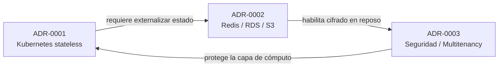

# Arquitectura de Aprende 360 — Documentación Viva

> **Proyecto Integrador:** Plataforma LMS *Aprende 360*
> **Asignatura:** Arquitectura de Software — NRC 60-95404
> **Autores:** Kevin Castro, Julian Ospina
> **Docente:** Juan Camilo Rodríguez Villada — UNIMINUTO de Dios, Ibagué (2026)

Este directorio consolida la **documentación viva de arquitectura** del proyecto Aprende 360. Su propósito es garantizar **trazabilidad completa** entre la *necesidad de negocio*, la *decisión de arquitectura* (ADR) y el *diseño* (diagramas como código en PlantUML), de forma versionable en Git.

---

## 1. Visión Global del Sistema

**Aprende 360** es una plataforma de gestión del aprendizaje (LMS) basada en el ecosistema **Moodle 4.x**, orientada a tres segmentos: **estudiantes de colegio**, **estudiantes universitarios** y **personal administrativo/docente**. La propuesta transforma el monolito tradicional de Moodle en un **monolito modular contenerizado**, escalable, seguro y desacoplado, capaz de absorber picos de **5.000 exámenes simultáneos**.

**Pila tecnológica de producción:**

| Capa | Tecnología | Decisión |
|------|-----------|----------|
| Orquestación | Kubernetes (EKS/GKE) + HPA | [ADR-0001](adr/0001-patron-arquitectonico.md) |
| Persistencia relacional | Amazon RDS Aurora MySQL Multi-AZ | [ADR-0002](adr/0002-sistema-de-persistencia.md) |
| Sesiones y caché | Redis Cluster (ElastiCache) + MUC | [ADR-0002](adr/0002-sistema-de-persistencia.md) |
| Almacenamiento de objetos | Amazon S3 + CloudFront CDN | [ADR-0002](adr/0002-sistema-de-persistencia.md) |
| Identidad / Seguridad | SSO OAuth2 / SAML2 / LDAP + WAF + RBAC | [ADR-0003](adr/0003-estrategia-seguridad.md) |

---

## 2. Índice de Decisiones de Arquitectura (ADRs)

| ID | Título | Estado | Escenarios / ASR | Vistas 4+1 |
|----|--------|--------|------------------|------------|
| [ADR-0001](adr/0001-patron-arquitectonico.md) | Patrón arquitectónico: Moodle en contenedores sobre Kubernetes | **Aceptado** | ASR-01, ASR-02, ASR-08 / ESC-01, ESC-06 | Desarrollo, Procesos, Física |
| [ADR-0002](adr/0002-sistema-de-persistencia.md) | Sistema de persistencia: RDS Aurora MySQL + Redis + S3 | **Aceptado** | ASR-03, ASR-06, ASR-07 / ESC-02, ESC-08 | Lógica, Procesos, Física |
| [ADR-0003](adr/0003-estrategia-seguridad.md) | Estrategia de seguridad: SSO, Multitenancy y Cifrado | **Propuesto** | ASR-04, ASR-05, ASR-09 / ESC-03, ESC-07 | Lógica, +1 Escenarios, Física |

**Interconexión de ADRs:**



- **ADR-0001 → ADR-0002:** el escalado horizontal solo es viable si la sesión se externaliza a Redis.
- **ADR-0002 → ADR-0003:** el cifrado en reposo (AES-256) se apoya en S3/RDS (ADR-0002).
- **ADR-0003 → ADR-0001:** el aislamiento *tenant-scoped* se implementa sobre el clúster de pods.

---

## 3. Índice de Diagramas (Diagram-as-Code)

Todos los diagramas están en **texto plano PlantUML** y se versionan en Git. Se renderizan sin herramientas locales usando [PlantUML Online](https://www.plantuml.com/plantuml/uml/) o la extensión *PlantUML* de VS Code.

| Diagrama | Archivo | Tipo | ADRs que ilustra |
|----------|---------|------|------------------|
| Contexto del Sistema (C4 Nivel 1) | [`diagrams/c4-contexto.puml`](diagrams/c4-contexto.puml) | C4 — Contexto | ADR-0001, ADR-0002, ADR-0003 |
| Proceso Clave: Examen de Alta Concurrencia | [`diagrams/secuencia-proceso-clave.puml`](diagrams/secuencia-proceso-clave.puml) | Secuencia UML | ADR-0001, ADR-0002, ADR-0003 |

**Renderizado rápido (si hay PlantUML + Java instalados):**

```bash
plantuml -tsvg docs/architecture/diagrams/c4-contexto.puml
plantuml -tsvg docs/architecture/diagrams/secuencia-proceso-clave.puml
```

---

## 4. Vistas Arquitectónicas (Modelo 4+1)

| Vista | Pregunta que responde | ADR principal | Diagrama asociado |
|-------|-----------------------|---------------|-------------------|
| **Escenarios (+1)** | ¿Qué comportamientos críticos de negocio debe soportar? | ADR-0001, ADR-0003 | `secuencia-proceso-clave.puml` |
| **Lógica** | ¿Cómo se estructura el dominio del sistema? | ADR-0002, ADR-0003 | `c4-contexto.puml` |
| **Desarrollo / Implementación** | ¿Cómo se organiza el código y las dependencias? | ADR-0001 | `c4-contexto.puml` |
| **Procesos** | ¿Cómo se comporta en ejecución ante concurrencia y fallos? | ADR-0001, ADR-0002 | `secuencia-proceso-clave.puml` |
| **Física / Despliegue** | ¿Dónde se despliegan los componentes y nodos? | ADR-0001, ADR-0002 | `c4-contexto.puml` |

---

## 5. Matriz de Trazabilidad: Necesidad → Decisión → Diseño

Esta matriz es el núcleo de la **sincronía topológica**: enlaza stakeholders, requerimientos, atributos ISO/IEC 25010, restricciones, vistas, ADR y diagramas.

| Necesidad / Stakeholder | ASR / Escenario | Atributo ISO 25010 | Restricción | Vista 4+1 | ADR / Decisión | Diagrama | Verificación |
|-------------------------|-----------------|--------------------|-------------|-----------|----------------|----------|--------------|
| Estudiante Universidad — Exámenes sin caídas | ASR-01 / ESC-01 | Desempeño | RES-01 | Procesos, Física | [ADR-0001](adr/0001-patron-arquitectonico.md), [ADR-0002](adr/0002-sistema-de-persistencia.md) | [`secuencia-proceso-clave.puml`](diagrams/secuencia-proceso-clave.puml) | JMeter 5.000 hilos |
| Equipo DevOps — Cero tiempo de parada | ASR-02 / ESC-06 | Disponibilidad / Mantenibilidad | RES-04 | Desarrollo, Despliegue | [ADR-0001](adr/0001-patron-arquitectonico.md) | [`c4-contexto.puml`](diagrams/c4-contexto.puml) | Despliegue Canary en Staging |
| Directivo — Control de costos de almacenamiento | ASR-03 / ESC-08 | Confiabilidad / Eficiencia | RES-02, RES-05 | Física, Lógica | [ADR-0002](adr/0002-sistema-de-persistencia.md) | [`secuencia-proceso-clave.puml`](diagrams/secuencia-proceso-clave.puml) | Métricas de facturación S3 |
| Auditor Seguridad — Protección datos de menores | ASR-05 / ESC-03 | Seguridad / Aislamiento | RES-03 | Lógica, +1 | [ADR-0003](adr/0003-estrategia-seguridad.md) | [`c4-contexto.puml`](diagrams/c4-contexto.puml) | SAST/DAST + pentest |
| Estudiante Colegio — Acceso móvil rápido | ASR-10 / ESC-05 | Usabilidad / Rendimiento | RES-01 | +1, Procesos | [ADR-0002](adr/0002-sistema-de-persistencia.md) | [`c4-contexto.puml`](diagrams/c4-contexto.puml) | Google Lighthouse con estrangulación 3G |
| Sistema SSO Institucional — Acceso unificado | ASR-04 / ESC-07 | Interoperabilidad | RES-03 | Lógica | [ADR-0003](adr/0003-estrategia-seguridad.md) | [`secuencia-proceso-clave.puml`](diagrams/secuencia-proceso-clave.puml) | Prueba SAML2/OAuth2 < 1 s |

---

## 6. Gestión de Deuda Técnica

La arquitectura adoptada **mitiga la deuda técnica** del despliegue monolítico tradicional de Moodle en los siguientes frentes:

| Deuda evitada | Riesgo origen | Mitigación arquitectónica |
|---------------|---------------|---------------------------|
| **Cuellos de botella de escalado vertical** | R-01 | Contenerización + HPA (ADR-0001) escala en < 90 s sin reescritura del núcleo. |
| **Pérdida de sesiones entre nodos** | R-01 | Sesiones externalizadas a Redis: capa web 100 % apátrida (ADR-0002). |
| **Almacenamiento local no escalable** | R-02 | Desacoplamiento de `MoodleData` a S3 + CDN, -70 % de I/O (ADR-0002). |
| **Riesgo regulatorio de datos** | R-03, R-05 | Multitenancy lógico + cifrado + logs inmutables (ADR-0003). |
| **Reescritura a microservicios** | — | Se conserva el núcleo Moodle (RES-01), evitando una migración costosa e innecesaria. |
| **Operación manual no reproducible** | RES-06 | Infraestructura como código (Terraform/Helm) para el pipeline CI/CD. |

Las **decisiones sensibles y difíciles de revertir** (patrón de despliegue, motor de persistencia, modelo de seguridad) se documentan como ADRs inmutables y versionados, evitando el *conocimiento tácito* y las regresiones de diseño.

---

## 7. Onboarding de Desarrolladores y Asistentes de IA

Este directorio está diseñado para que un **nuevo desarrollador** o un **asistente de IA** comprenda y evolucione el sistema de forma autónoma:

1. **Punto de entrada único:** este `README.md` ofrece el índice y la visión global sin necesidad de leer toda la memoria técnica.
2. **Contexto primero:** el diagrama [`c4-contexto.puml`](diagrams/c4-contexto.puml) da el panorama de actores, sistema y dependencias externas en una sola vista.
3. **Decisiones autoexplicadas:** cada ADR documenta *contexto, alternativas, decisión y consecuencias*, permitiendo entender **por qué** se hizo algo sin preguntar al equipo.
4. **Formato consumible por IA:** los archivos Markdown y PlantUML en texto plano son directamente indexables por asistentes de IA, que pueden generar preguntas, nuevos ADRs o diagramas sobre el mismo repositorio.
5. **Trazabilidad verificable:** la matriz de la sección 5 permite rastrear cualquier cambio desde el código hasta la necesidad de negocio que lo motiva.
6. **Bajo acoplamiento conceptual:** cada decisión está enlazada a las demás (ADR interconectados), de modo que modificar una obliga a revisar sus dependencias.

**Flujo de incorporación sugerido:**
`README.md` → `c4-contexto.puml` → ADR-0001 → ADR-0002 → ADR-0003 → `secuencia-proceso-clave.puml`

---

## 8. Estructura del Repositorio

```
/docs/architecture/
├── README.md                              # Este índice y visión global
├── adr/
│   ├── 0001-patron-arquitectonico.md      # Kubernetes / contenedores
│   ├── 0002-sistema-de-persistencia.md    # RDS Aurora + Redis + S3
│   └── 0003-estrategia-seguridad.md       # SSO + Multitenancy + Cifrado
└── diagrams/
    ├── c4-contexto.puml                   # C4 Nivel 1 — Contexto
    └── secuencia-proceso-clave.puml       # Secuencia — Examen de alta concurrencia
```

---

## 9. Convenciones de PlantUML

- Codificación **UTF-8** y extensión `.puml`.
- Diagramas de contexto con la librería estándar **C4-PlantUML** (`C4_Context.puml`).
- Diagramas de comportamiento con notación **UML** estándar (secuencia).
- Cada diagrama incluye metadatos de trazabilidad hacia sus ADR en el bloque de comentarios.

---

## 10. Referencias

- Bass, L., Clements, P., & Kazman, R. (2021). *Software Architecture in Practice* (4th ed.). Addison-Wesley.
- ISO/IEC 25010:2023 — *Systems and software Quality Requirements and Evaluation (SQuaRE)*.
- Moodle Docs. (2025). *Moodle Universal Cache (MUC) & Performance recommendation guidelines*. Moodle HQ.
- Documento técnico: *Propuesta de Arquitectura de Software para la Plataforma Integradora LMS Aprende 360* (Castro & Ospina, 2026).
